<p align="center">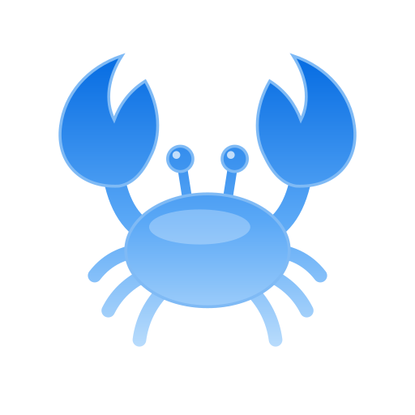</p>

<h1 align="center">KraBness</h1>

<p align="center"><b>Your AI coding agents run on your PC. You drive them from your phone.</b><br>
Self-hosted, any model, no vendor lock-in.</p>

<p align="center"><a href="README.ru.md">Русская версия</a></p>

---

KraBness is a small hub that runs on your Windows PC. It starts AI coding agents ([opencode](https://opencode.ai) with any model, or the official [Claude Code](https://claude.com/claude-code) CLI on your subscription). The web UI and the Android app then show the same live session from anywhere. Start a task at your desk, approve a command from the couch, read the result on the bus.

<p align="center">
  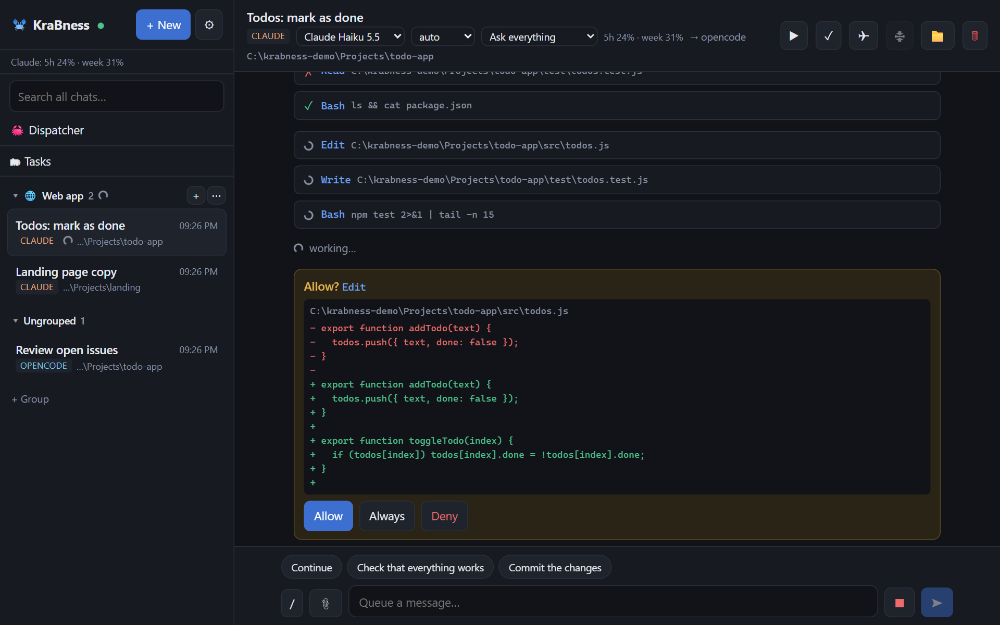
  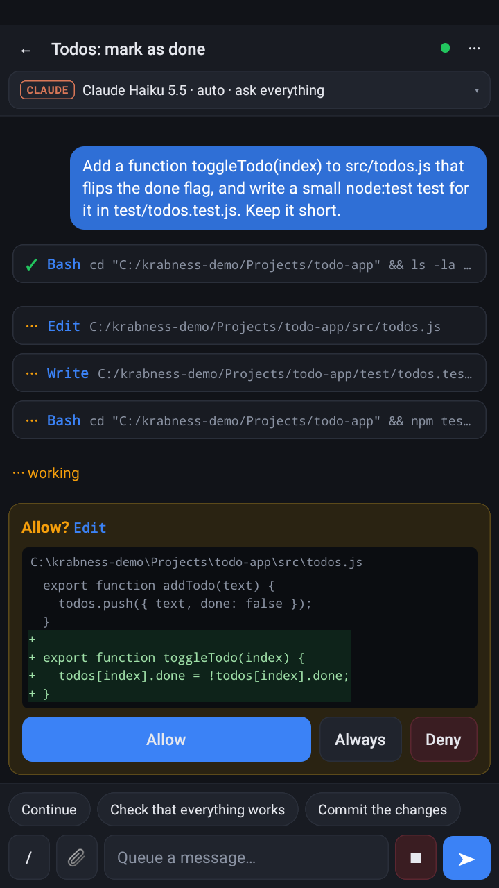
</p>
<p align="center">
  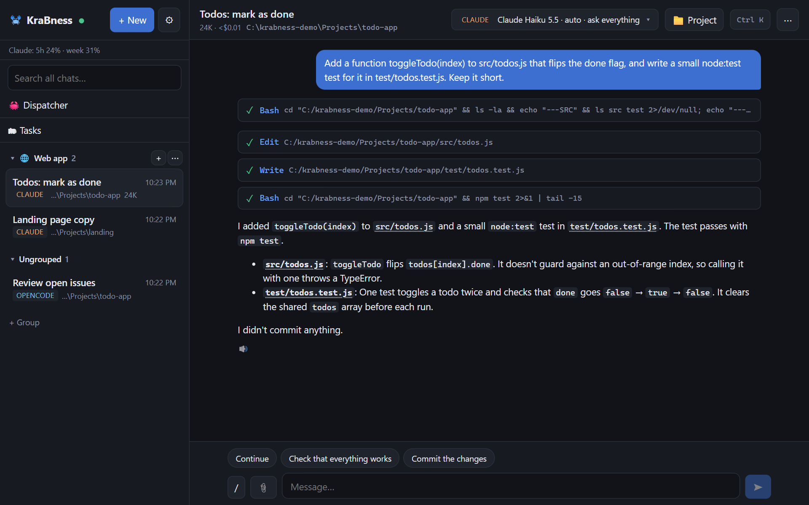
  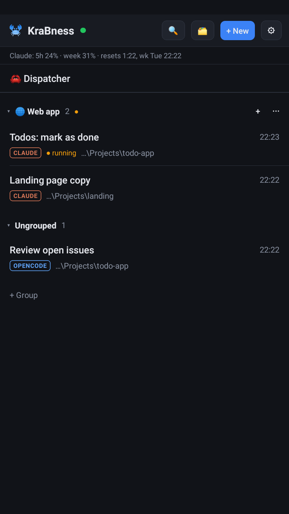
</p>

```
 phone (Android app) ┐               ┌─► opencode   local models, LM Studio, Ollama, free cloud models, any API key
 browser (web UI)    ├──Tailscale──► KraBness hub (your PC)
                     ┘               └─► claude     the official Claude Code CLI, your subscription
                                          │
                                          └─ event journal, files, approvals, notifications, updates
```

## What you get

- **One live session everywhere.**
  - Every event lands in a journal, clients replay what they missed.
  - The phone keeps a local cache and a draft of what you were typing.
- **Approvals and questions** from the agent arrive as buttons. Answer in the web UI, in the app, from a notification or in Telegram.
- **Files both ways.** Attach files, photos or a camera shot; the agent sends files back to you.
- **Any model.**
  - opencode works with OpenAI (including a ChatGPT subscription), OpenRouter, DeepSeek, Gemini, Kimi, GLM.
  - It also works with your own server (LM Studio, Ollama, vLLM) and with free models.
  - Claude Code uses your Claude subscription, through the official CLI only.
- **Project view without the agent**: git diff, file browser, editing text files by hand, a mini terminal.
- **The Dispatcher**: a personal assistant that runs your sessions and can control the PC, on Claude or any other model with tools ([below](#the-dispatcher)).
- **Tasks**: give a goal, get back a reviewed change that waits for your decision, with a report on how checks and review went ([below](#tasks-and-auto-check)).
- **Live pages in the chat** and **layout comments** right on your dev server's page ([below](#live-pages-and-layout-comments)).
- **Search over all chats and a token usage page** ([below](#search-and-token-usage)).
- **Handy extras**:
  - Claude limits in %, with auto-continue after a limit resets;
  - a separate git branch per session;
  - session groups with a shared prompt;
  - your own MCP servers and skills for both engines;
  - continuing existing Claude Code sessions;
  - a separate Telegram bot for a session: you and people you invite write to the agent from Telegram, files included;
  - `@` in the message box to pick a project file, and file paths in answers that open the file;
  - a button to compact the context, and a thinking level per session;
  - a screenshot of the PC screen (needs ffmpeg: `winget install Gyan.FFmpeg`);
  - voice input and read-aloud;
  - putting the PC to sleep and waking it up.
- **Notifications**: from the app itself or via a Telegram bot (with SOCKS5/HTTP proxy support).
- **Updates in one tap.** The hub checks GitHub once a day, installs a new version and rolls back if it fails.
- **English and Russian** interface, following the system language by default.

<p align="center">
  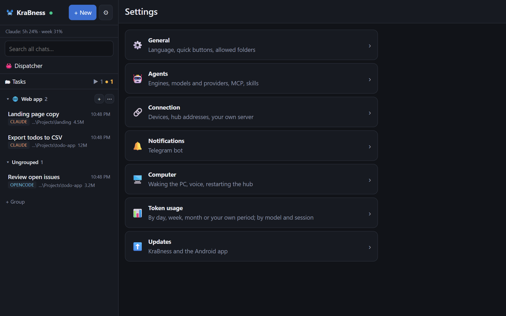
</p>

## The Dispatcher

A pinned chat with an assistant that works for you rather than on one project. Call it from the phone, the browser or by voice.

<p align="center">
  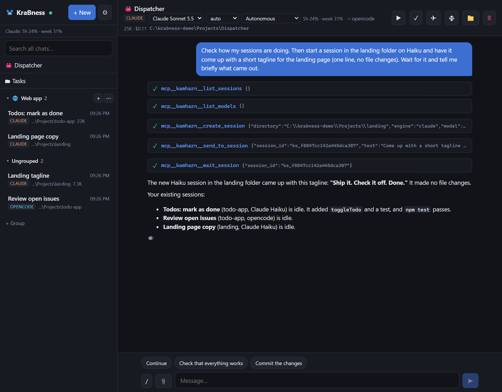
  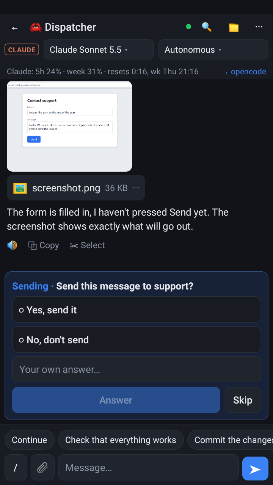
</p>

- **It hands out work.** It starts coding sessions and tasks, watches them, answers their questions when the answer is obvious and reports back. It won't approve commands that look irreversible (push, deleting) by itself: those wait for your "yes". This is a pattern check plus an instruction to the model, not a guarantee.
- **It can control the PC (Windows).** Screenshots, mouse, keyboard, opening sites. Needs [uv](https://docs.astral.sh/uv/) (the installer offers it); to send you a screenshot in the chat it also needs ffmpeg.
- **You can talk to it.**
  - On the PC: say the wake word and the command, and the start of the answer plays through the speakers. Recognition (Whisper) and speech (Piper) run locally, and phrases without the wake word go nowhere. Settings → Computer → Voice on the PC. Needs uv and downloads its models on first start; an NVIDIA GPU makes it fast, without one it falls back to the CPU. **Russian only for now.**
  - On the phone: press the microphone, speak, press stop. In Talk mode the text goes out by itself and the first paragraph of the answer is read aloud. It is on by default for the Dispatcher, and any session has it in the ⋯ menu. The phone needs a speech recognition service.
- **It remembers.** Two plain files in its folder hold what it should always know. On top of that, a long memory in the hub's database on this PC keeps what was said in all your chats, including earlier ones, day by day, so you can ask what was done on a given day. What it recalls goes to the Dispatcher's model like any other context. Close a group for memory in its settings. Look things up or forget matching records in Settings → Agents → Memory in the web UI (up to five per press; the diary and the chats themselves stay). It searches by words out of the box; a diary and search by meaning need a local OpenAI-compatible model (`memory.writer` and `memory.embeddings` in the config). In LM Studio the model must already be loaded.
- **Any brain, one chat.** Settings → Agents → Dispatcher: the main model and a fallback. No Claude? It works on any opencode model with tools from the start. With Claude as the main one and a fallback chosen, it moves to the fallback when Claude hits its limit or isn't signed in, and comes back afterwards.

<p align="center">
  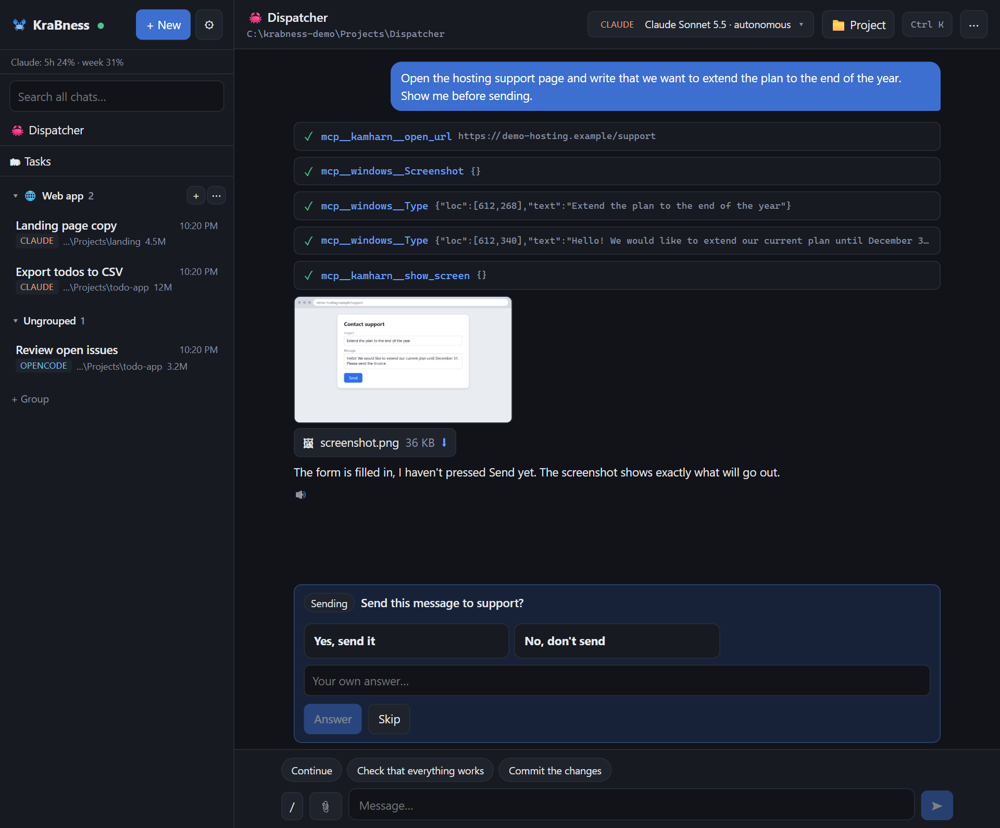
</p>
<p align="center">
  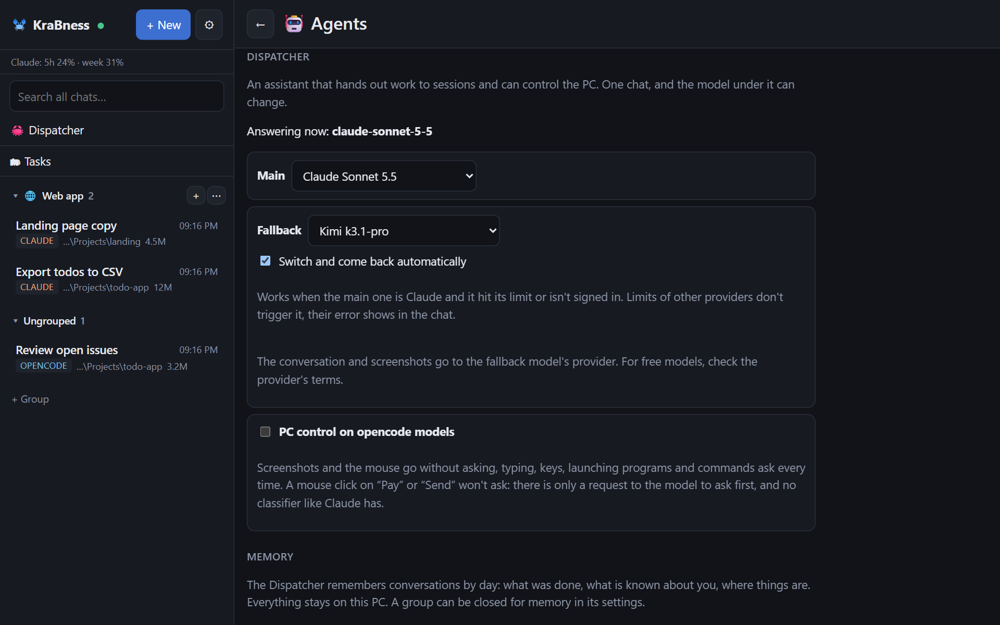
  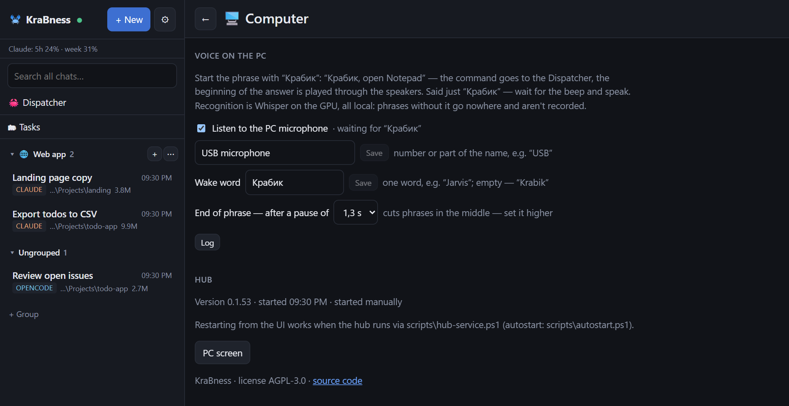
</p>

**What to know about PC control on opencode models.** It is off by default, turn it on in the same settings. Claude has a safety classifier, opencode models don't:

- screenshots and the mouse go without asking;
- typing, keys, launching programs and commands ask every time, with what exactly on the card;
- a mouse click on "Pay" or "Send" does **not** ask: there is only an instruction to the model to ask first, and how well it follows that depends on the model.

The model needs vision, otherwise it works without PC control. Your conversation and screenshots go to that model's provider. Tested on Kimi k3.1-pro; other providers go through the same code but weren't tried live.

## Tasks and auto-check

Give a goal and a project, and the hub runs the work from start to report:

1. An agent works in a separate copy of the project, on its own branch.
2. If check commands are saved for the project, the hub runs them and a failure goes back to the agent. Save them once in a chat with ⋯ → Auto-check (it suggests tests, typecheck and lint from the project files). Without them this step is skipped and the report says "not configured".
3. A review model (by default on opencode, otherwise on the worker's engine) reviews the diff, the agent fixes the remarks, up to two review rounds.
4. You get a notification and a report: **merge** into the main branch as one commit, ask for **another round** with a comment, or **discard**.

The hub merges nothing into the main branch without your decision. Failed checks or open remarks don't stop the task from reaching you: the report says how they went. If the agent has a question, the task shows it and waits for you.

<p align="center">
  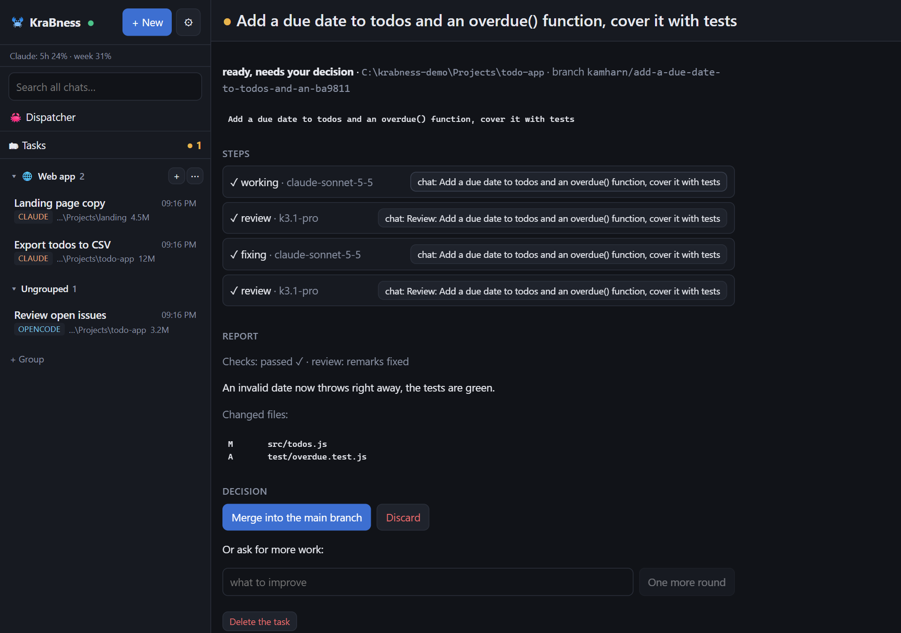
  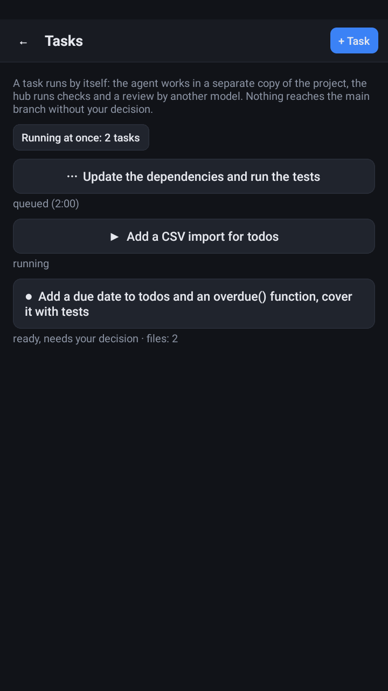
</p>

- **Queue.** Tasks start as slots free up (two at once by default), or at night: "Start at night" waits until 02:00.
- **Any engine.** Pick the models for the work and for the review. By default the work goes to Claude if you're signed in, the review to opencode.
- **Auto-check in any session.** ⋯ → Auto-check in the chat header turns on checks after each agent turn. A red check goes to the agent, up to three attempts, and stops early if the same error comes back.
- **Hit a Claude limit?** The session waits for the reset and continues by itself. "Don't wait" hands the work over to an opencode model.

<p align="center">
  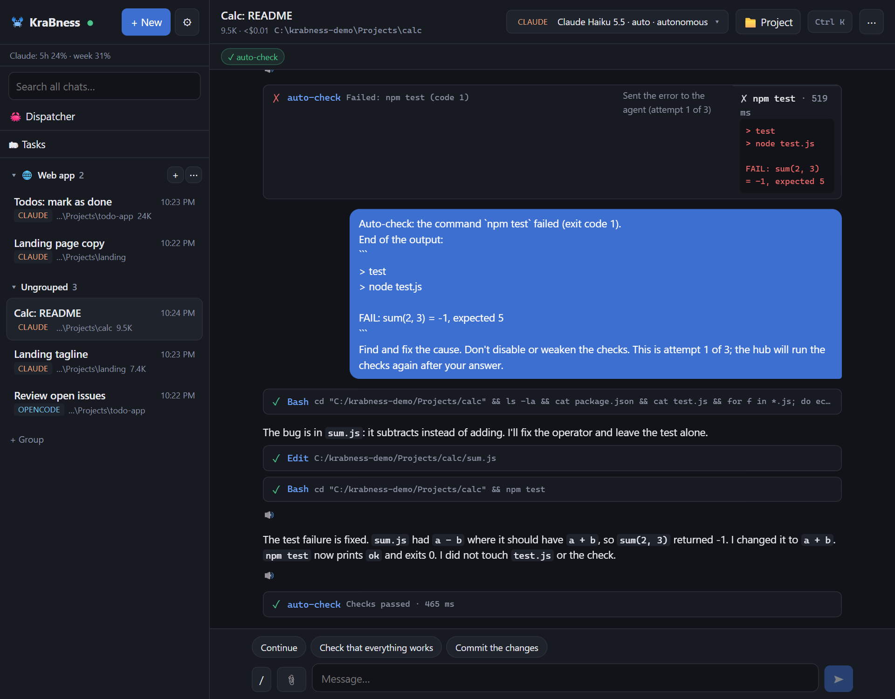
</p>

## Live pages and layout comments

- **Live pages.** An ```` ```html ```` block in an agent's answer runs as a page right in the chat: 3D, charts, small demos, full screen with one tap. It runs in a sandbox with no access to the hub, your token or the chat. An `.html` file in the project view has a Run button.
- **Dev-server preview.** Open a port of your dev server on the phone or in another browser through the hub.
- **Layout comments.** Open the preview in comment mode, tap an element and write what's wrong. The agent gets your text with the element's selector, a piece of its HTML, its size and styles, and a screenshot.

<p align="center">
  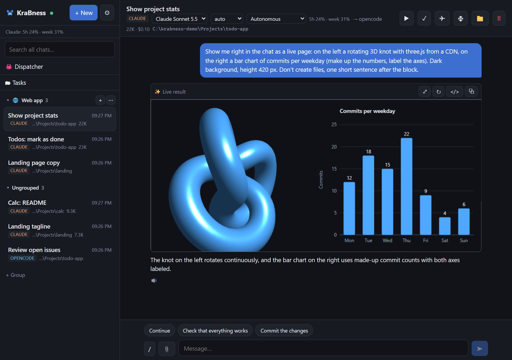
  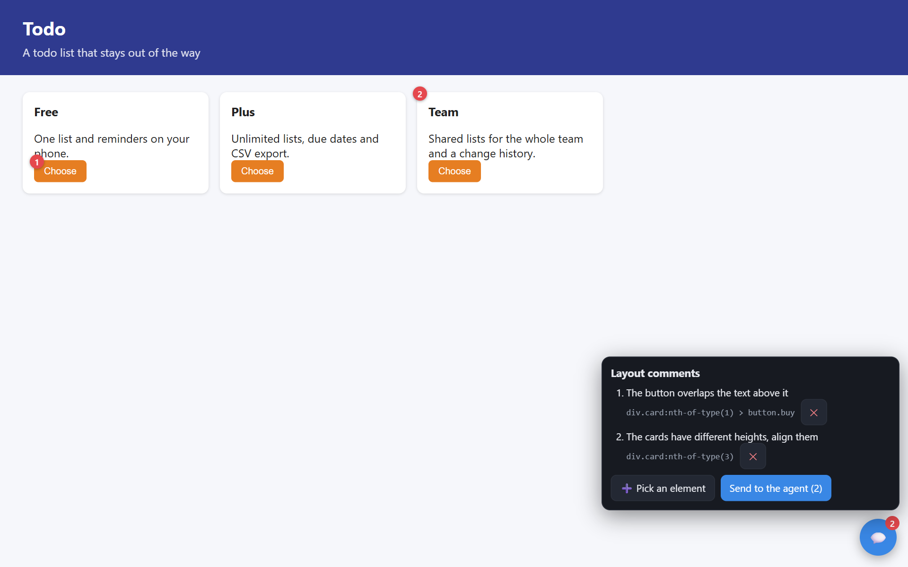
</p>

## Search and token usage

- **Search over all chats**, in the web UI and in the app. It matches word beginnings in what you and the agents wrote, and a click opens the session.
- **Token usage** (Settings → Token usage): new tokens, cache reads and the cost at API prices, as a calendar heat map, by day, by model and by session. On a subscription the cost is only a reference.

<p align="center">
  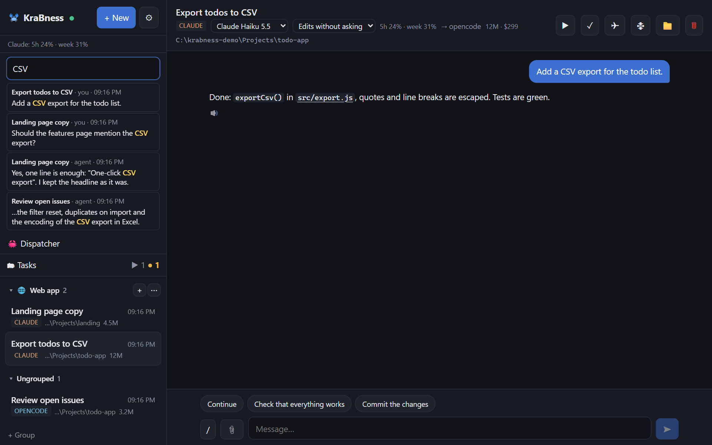
  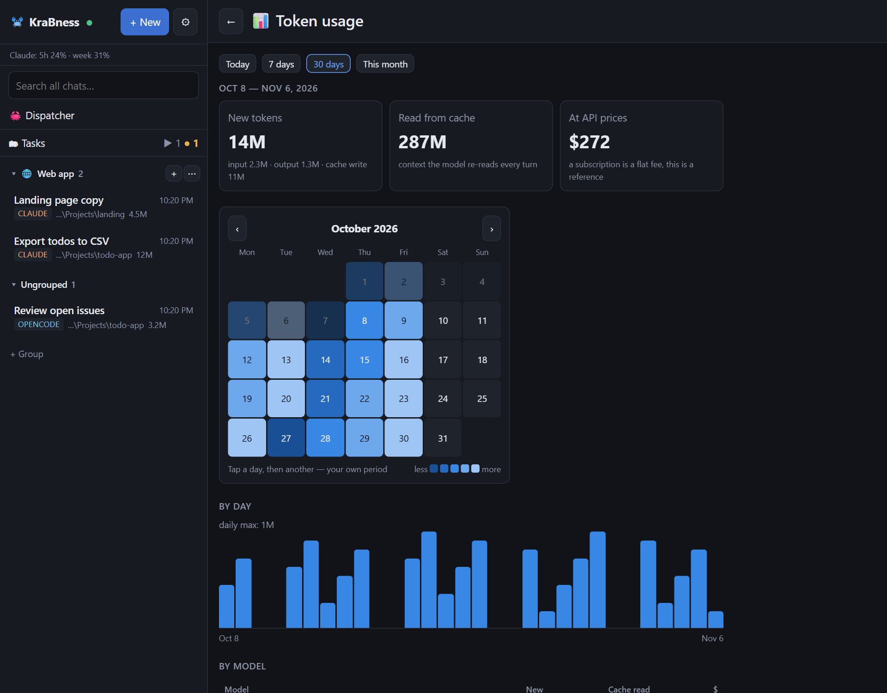
</p>

## Requirements

- Windows 10 or 11 (the hub, its supervisor and the PC sleep and screenshot features are Windows only for now).
- [Node.js](https://nodejs.org) 22 or newer (24 LTS recommended). The installer offers to install it.
- At least one agent:
  - **opencode**: `npm i -g opencode-ai`. It runs free and local models out of the box.
  - **Claude Code**: `npm i -g @anthropic-ai/claude-code`. Sign in once with your own account: in KraBness (Settings → Engines → Sign in on the PC) or with `claude auth login` in a terminal. A Claude subscription works, and so does an Anthropic API key (pay as you go, Settings → Engines).
- [Tailscale](https://tailscale.com/download) on the PC and on the phone, signed in to the same account. It gives the phone a private, encrypted path to your PC with no port forwarding.
- Optional: [uv](https://docs.astral.sh/uv/) for PC control and voice on the PC (the installer offers it).

## Install

Open PowerShell (not as administrator) and run:

```powershell
irm https://github.com/kamo4er/KraBness/releases/latest/download/install.ps1 | iex
```

The installer:
- checks Node.js and offers to install it if it is missing;
- downloads the latest release to `%USERPROFILE%\KraBness`, then installs the dependencies and builds the web UI;
- offers to install what is missing: opencode, Claude Code, uv (optional), Tailscale;
- asks whether to add a firewall rule for Tailscale and whether to start KraBness with Windows;
- starts the hub and opens http://127.0.0.1:7420.

<details>
<summary>Manual install</summary>

1. Download `krabness-<version>.zip` from the [latest release](https://github.com/kamo4er/KraBness/releases/latest) and unpack it to a folder.
2. In that folder, build it:
   ```
   npm ci
   npm run web:build
   ```
3. Allow the phone to connect over Tailscale (once, as administrator):
   `powershell -ExecutionPolicy Bypass -File scripts\firewall-tailscale.ps1`
4. Start the hub under the supervisor:
   `powershell -ExecutionPolicy Bypass -File scripts\hub-service.ps1 -Detach`
   The supervisor restarts the hub and installs updates.
5. Optionally, start it with Windows:
   `powershell -ExecutionPolicy Bypass -File scripts\autostart.ps1`

For a quick try without the supervisor, `scripts\start-hub.cmd` is enough (updates then have to be installed by hand). One installation per PC: autostart and the watchdog task use fixed names.

</details>

## Connect your phone

1. **Tailscale.** Install it on the phone and sign in to the same account as on the PC.
2. **The app.** Download `KraBness-<version>.apk` from the [latest release](https://github.com/kamo4er/KraBness/releases/latest), or open Settings → Android app → Download APK in the web UI. Install it; Android asks to allow installs from this source.
3. **Pairing.**
   1. In the web UI on the PC, open Settings → Connect a device. The code lives for 5 minutes.
   2. In the app, scan the QR code, or type the PC's Tailscale address and the 6-digit code.

That's it: sessions, chat, approvals and files are on the phone. Requests from the PC itself are trusted. Other devices need the token they get when pairing. Agents work only inside the allowed folders (`%USERPROFILE%\Projects` by default, change it in Settings).

No app? Open `http://<PC Tailscale IP>:7420` in the phone's browser and pair with the same code.

### Without Tailscale: your own server (optional)

If Tailscale doesn't work from your phone (for example, a VPN on the PC breaks it on mobile data), the hub can go through your own VPS instead. The PC keeps an outgoing SSH tunnel to the server, and the server serves the hub over HTTPS with a free Let's Encrypt certificate. Nothing has to be opened on the PC or the home router.

1. You need a VPS with Ubuntu or Debian where ports 80 and 443 are free. No domain needed: the address will be `https://krab.<server-ip>.sslip.io`.
2. In the web UI on the PC, open Settings → Remote access via your own server and copy the command. Run it on the VPS as root. It installs Caddy and a `krabtunnel` user whose key may only open this one tunnel ([`scripts/vps-setup.sh`](scripts/vps-setup.sh), safe to run again).
3. Enter the server IP and press "Save and connect". The hub checks the address from the outside.

The new address goes into the pairing QR, and an already paired app picks it up by itself the next time it connects. The app tries all known addresses and uses the one that answers: Tailscale at home, your server on mobile data.


## Notifications

The app learns that the agent needs an approval, has a question, hit an error or finished. Pick any of the channels below. While you are active in the web UI on the PC, notifications are muted.

- **From the app (default).** The hub sends notifications over its connection and the app shows them. Turn on Settings → Stay connected in background, so a minimized app keeps the connection.
- **Telegram.** Create a bot with [@BotFather](https://t.me/BotFather) and paste its token into Settings → Telegram notifications. Then send `/start <code>` to the bot.
  - Allow and Deny buttons work right in the chat.
  - Replying to a notification sends the text to the agent.
  - If Telegram is blocked where you live, add a SOCKS5 or HTTP proxy there.

Want notifications even when Android has closed the app? Use Telegram: it doesn't depend on the app at all.

## Updates

The hub checks [GitHub Releases](https://github.com/kamo4er/KraBness/releases) once a day. When a new version is out, the web UI and the app show a banner with what's new and an **Update** button. Then:
1. The hub downloads the release and restarts.
2. The supervisor swaps the files, installs the dependencies and builds the web UI.
3. If the new version fails to install or crashes right after start, the supervisor puts the previous one back.

Your data, settings and keys are not touched. The phone app updates itself afterwards. Settings → Updates has "Check now" and a switch for the daily check.

Prefer email? Click **Watch → Custom → Releases** on GitHub.

## Waking the PC (optional)

A sleeping PC is unreachable over the network, so a small "relay" wakes it up. The relay is `scripts/nas-wake/wake.py`, running on any always-on device in the same home network (a NAS, a Raspberry Pi, a router with Python 3.8+). The phone calls the relay over Tailscale, and the relay sends the PC a Wake-on-LAN packet. Everything else works without it; you just won't have the "Wake the PC" button.

1. Enable Wake-on-LAN on the PC:
   - in the BIOS: Wake on LAN / Power On By PCI-E;
   - in Windows, Device Manager → network adapter → Advanced: *Wake on Magic Packet* = Enabled;
   - in Power Management: allow the device to wake the computer.

   A cable works best: Wake-on-LAN over Wi-Fi rarely works.
2. Install Tailscale on the relay device (same account).
3. In the web UI on the PC, open Settings → Wake the PC. Pick the network adapter, press "Generate" for a token, and download `wake.py`.
4. On the relay, put `wake.py` and a `token` file with that token next to it. Then run:
   ```
   python3 wake.py --bind <relay Tailscale IP>
   ```
5. In Settings, enter `http://<relay Tailscale IP>:7421`, then press "Save and check".

<details>
<summary>Autostart of the relay</summary>

Linux (Raspberry Pi etc.): `/etc/systemd/system/kamharn-wake.service`

```
[Unit]
Description=KraBness wake relay
After=network-online.target tailscaled.service
Wants=network-online.target

[Service]
WorkingDirectory=/home/pi/kamharn-wake
ExecStart=/usr/bin/python3 wake.py --bind <Tailscale IP>
Restart=always
User=pi

[Install]
WantedBy=multi-user.target
```

then `sudo systemctl enable --now kamharn-wake`.

Synology: Control Panel → Task Scheduler → Create → Triggered Task, event "Boot-up". Use one of these scripts:
- `cd ~/kamharn-wake && python3 wake.py --bind <Tailscale IP>`;
- `scripts/nas-wake/run.sh`, which also restarts the relay if it crashes.

</details>

## FAQ

**Whose Claude account is used?** Yours. Claude Code keeps the sign-in on your PC, KraBness only starts it. Nobody else's account ships with KraBness. Settings → Engines shows who is signed in, and lets you sign in again or use an API key instead.

**Is my Claude subscription used legitimately?** Yes. KraBness runs the official `claude` CLI, the same one you use in a terminal. It never calls the API with your session tokens.

**Who can reach my PC?** Only devices that you paired with a code. Over Tailscale the hub isn't on the public internet at all, and the firewall rule allows only the Tailscale interface. With your own server the hub is reachable from the internet, but every request needs a device token; a pairing code works only for 5 minutes after you start pairing on the PC, and five wrong codes burn it. Requests that come through the tunnel never count as local, even though they arrive from 127.0.0.1. Don't publish the hub any other way (`tailscale funnel`, port forwarding, your own proxy): a paired device can run commands on your PC, that's the point of the app.

**Are updates safe?** Every release archive is signed by the author's key, and the hub refuses to install an archive without a valid signature, even if it comes from the right GitHub page.

**macOS or Linux?** The clients work anywhere. The hub itself is Windows only for now (its supervisor, sleep and screenshot features).

**How do I uninstall?**
1. Stop the hub and turn off autostart:
   ```
   scripts\hub-service.ps1 -Stop
   scripts\autostart.ps1 -Remove
   ```
2. Delete the folder.
3. The firewall rule is called "KamHarn hub (Tailscale)".
4. If you set up your own server: on the VPS, delete the `krabtunnel` user and the block between the `# >>> krabness` markers in `/etc/caddy/Caddyfile`.

## Config

`config/kamharn.json` is created on the first run. It holds:
- the listen addresses and the port;
- the allowed folders;
- the engines (`engines.claude.userMcp: true` also loads the MCP servers from your Claude Code settings);
- the language (`language`: `auto`, `en` or `ru`);
- updates (`updates.auto: false` turns off the daily check);
- the Dispatcher's long memory (`memory.enabled: false` turns it off; `memory.writer` and `memory.embeddings` are the local models for the diary and search by meaning);
- remote access via your own server (`remote`; the hub's tunnel key is `config/remote_ed25519`);
- addresses behind your own reverse proxy, for example a NAS on a public IP (`publicUrls`, they go into the pairing QR). Add the PC's home address to `listen` and run `scripts\firewall-lan.ps1 -Proxy <proxy IP>` as administrator: the hub port then accepts only the proxy.

Almost everything is also in the UI.

## Development

```
npm run hub               # the hub by hand, UI at http://127.0.0.1:7420
npm run web:dev           # UI with hot reload on :5173
npm run typecheck
npm test                  # unit tests
npm run test:integration  # live: real opencode and claude (uses a little quota)
```

Notes for coding agents (and humans) are in [AGENTS.md](AGENTS.md).

## License

KraBness is licensed under the [GNU AGPL-3.0](LICENSE). Use it, change it, share it. If you distribute a modified version or run it as a service for other people, publish its source code under the same license.

Copyright (C) 2026 kamo4er
