<p align="center">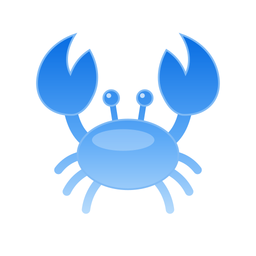</p>

<h1 align="center">KraBness</h1>

<p align="center"><b>AI-агенты работают на твоём ПК. Управляешь ими с телефона.</b><br>
И они не встают, когда у Claude кончился лимит.</p>

<p align="center"><a href="README.md">English version</a> · <a href="CHANGELOG.ru.md">История изменений</a><br>
<a href="https://github.com/kamo4er/KraBness/actions/workflows/test.yml"></a></p>

<p align="center">
  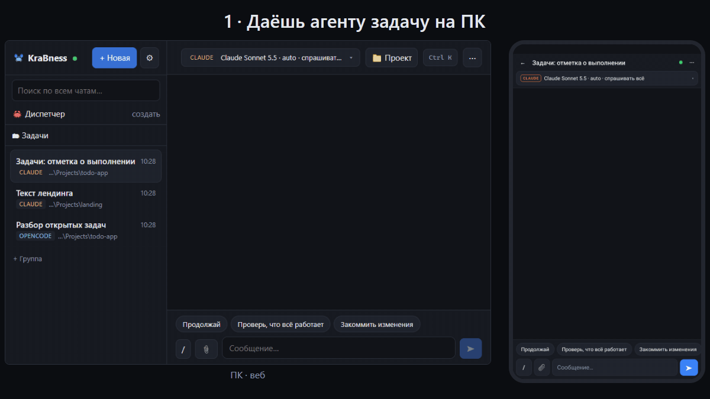
</p>

- **Пульт для агентов.** [Claude Code](https://claude.com/claude-code) или [opencode](https://opencode.ai) работает на твоём ПК. Подтверждения, вопросы и файлы приходят тебе на телефон, в браузер или в Telegram. Начал задачу за столом, разрешил команду с дивана, прочитал результат в автобусе.
- **Лимит не тормозит.** Подходит к концу лимит Claude: одно касание, и работа идёт дальше на любой другой модели, локальной, бесплатной или по твоему ключу. Или сессия сама дождётся сброса и продолжит.
- **Задачи с ревью.** Даёшь цель. Агент работает в своей ветке, хаб гоняет твои тесты и ревью другой моделью, а результат ты вливаешь одним касанием.

Свой сервер, любые модели, без привязки к одному вендору. Хаб работает под Windows, клиенты где угодно (веб-интерфейс и Android-приложение).

## Быстрый старт

1. В PowerShell на ПК (не от администратора):
   ```powershell
   irm https://github.com/kamo4er/KraBness/releases/latest/download/install.ps1 | iex
   ```
   Установщик проверит Node.js, предложит поставить opencode, Claude Code и Tailscale и откроет http://127.0.0.1:7420.
2. Поставь [Tailscale](https://tailscale.com/download) на телефон и войди в тот же аккаунт, что на ПК.
3. Поставь Android-приложение (`KraBness-<версия>.apk` из [последнего выпуска](https://github.com/kamo4er/KraBness/releases/latest)), потом в веб-интерфейсе открой «Настройки → Подключить устройство» и отсканируй QR приложением.

Подробнее: [что нужно](#что-нужно), [установка](#установка), [подключить телефон](#подключить-телефон).

<p align="center">
  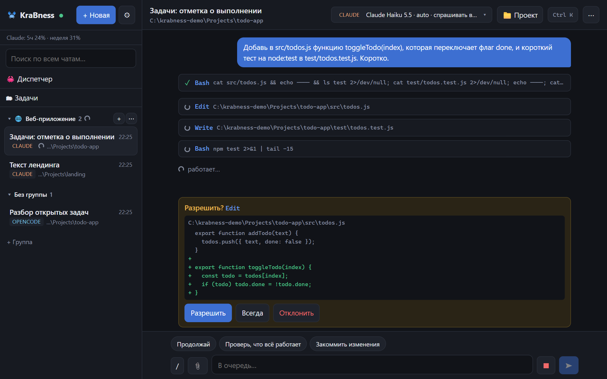
  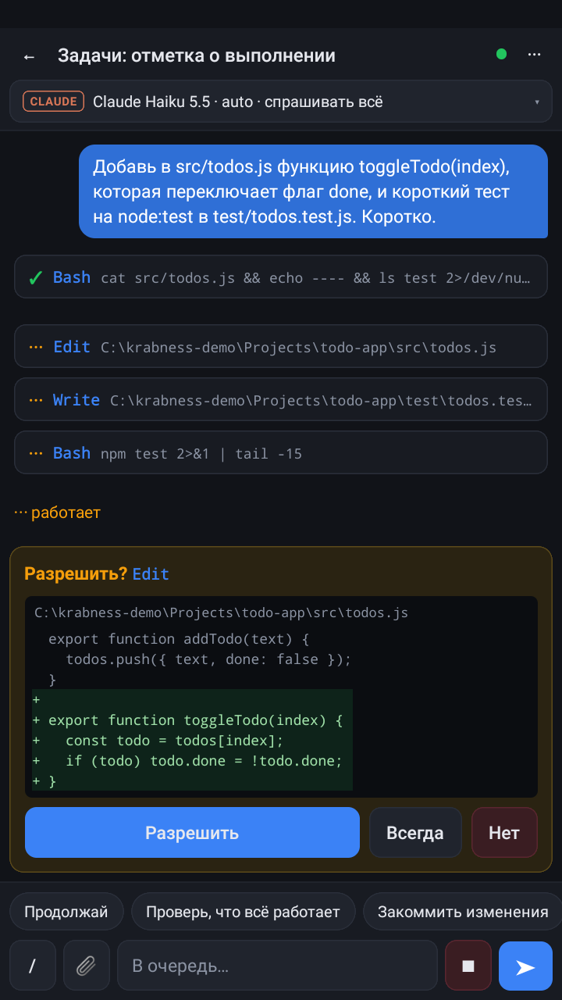
</p>

```
 телефон (приложение) ┐               ┌─► opencode   локальные модели, LM Studio, Ollama, бесплатные облачные, любой API-ключ
 браузер (веб-UI)     ├──Tailscale──► хаб KraBness (твой ПК)
                      ┘               └─► claude     официальный Claude Code CLI, твоя подписка
                                           │
                                           └─ журнал событий, файлы, подтверждения, уведомления, обновления
```

## Сессии

Одна живая сессия везде: каждое событие ложится в журнал, клиенты догружают пропущенное. Телефон хранит кэш чатов и черновик того, что ты начал писать.

- **Чистая шапка.** Название, одна плашка «модель · рассуждение · подтверждения» (нажми, чтобы поменять; там же лимиты Claude) и меню ⋯ со всем остальным: файлы и изменения, превью dev-сервера, ветка сессии, автопроверка, сжатие контекста, бот в Telegram, удаление. Что включено, видно зелёными плашками под шапкой.
- **Палитра команд** в вебе: Ctrl+K и несколько букв действия, настройки или сессии.
- **Подтверждения и вопросы** приходят кнопками. В карточке подтверждения видны только строки, которые меняются. Ответить можно в вебе, в приложении, прямо из уведомления или в Telegram.
- **Файлы в обе стороны.** Приложи файл, фото или снимок с камеры; агент присылает файлы тебе.
- **Просмотр проекта без агента**: git diff, файлы, правка текстовых файлов руками, мини-терминал.

<p align="center">
  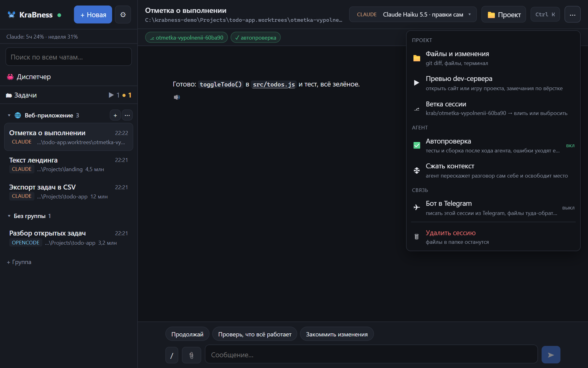
  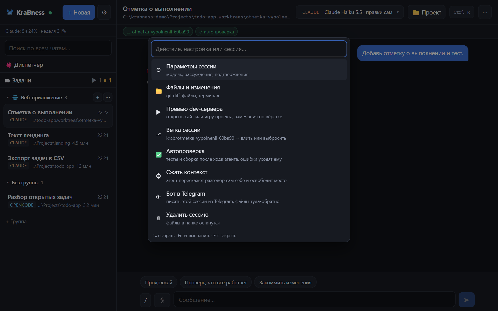
</p>
<p align="center">
  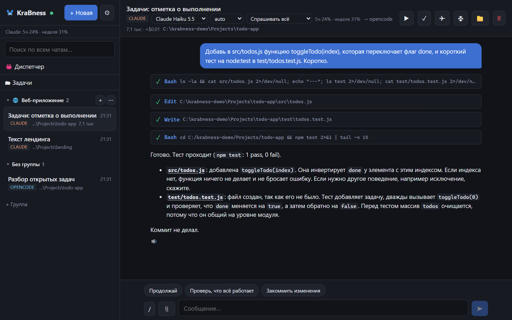
  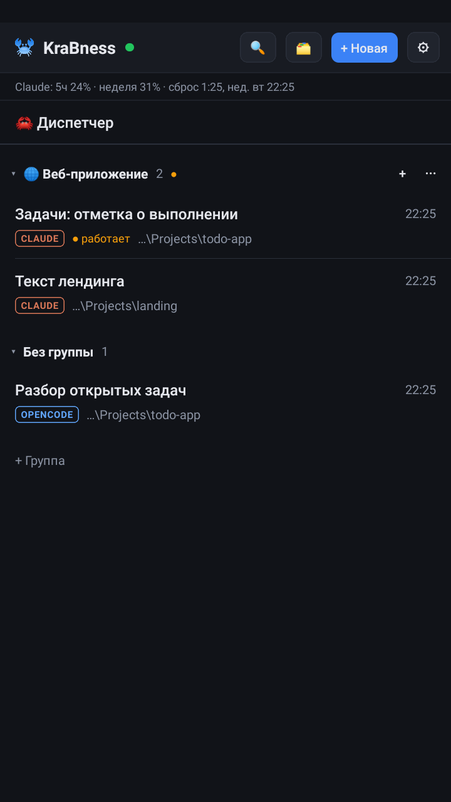
</p>

<details>
<summary>Ещё в сессиях</summary>

- **Любые модели.** opencode работает с OpenAI (в том числе по подписке ChatGPT), OpenRouter, DeepSeek, Gemini, Kimi, GLM, со своим сервером (LM Studio, Ollama, vLLM) и с бесплатными моделями. Claude Code работает по твоей подписке Claude, только через официальный CLI.
- Лимиты Claude в процентах и автопродолжение после сброса лимита.
- Отдельная git-ветка на сессию.
- Группы сессий с общим промптом.
- Свои MCP-серверы и скиллы для обоих движков.
- Продолжение сессий Claude Code.
- Отдельный Telegram-бот на сессию: ты и те, кого пригласишь, пишете агенту из Telegram, с файлами.
- `@` в поле ввода, чтобы выбрать файл проекта, и пути к файлам в ответах, которые открывают файл.
- Сжатие контекста и уровень рассуждений на сессию.
- Снимок экрана ПК (нужен ffmpeg: `winget install Gyan.FFmpeg`).
- Голосовой ввод и озвучка.
- Усыпить и разбудить ПК.
- Русский и английский интерфейс, по умолчанию как в системе.

</details>

## Задачи и автопроверка

Даёшь цель и проект, а хаб ведёт работу от начала до отчёта:

1. Агент работает в отдельной копии проекта, в своей ветке.
2. Если для проекта сохранены команды проверки, хаб гоняет их, и ошибка уходит агенту. Сохрани их один раз в чате: ⋯ → Автопроверка (тесты, typecheck и lint она предложит по файлам проекта). Без них шаг пропускается, в отчёте будет «не настроены».
3. Модель-ревьюер (по умолчанию на opencode, иначе на движке исполнителя) делает ревью диффа, агент правит замечания, до двух кругов ревью.
4. Тебе приходит уведомление и отчёт: **влить** в основную ветку одним коммитом, попросить **ещё круг** с комментарием или **выбросить**.

Сам хаб ничего не вливает в основную ветку без твоего решения. Упавшие проверки и оставшиеся замечания не останавливают задачу: в отчёте видно, чем они кончились. Если у агента вопрос, задача покажет его и подождёт тебя.

<p align="center">
  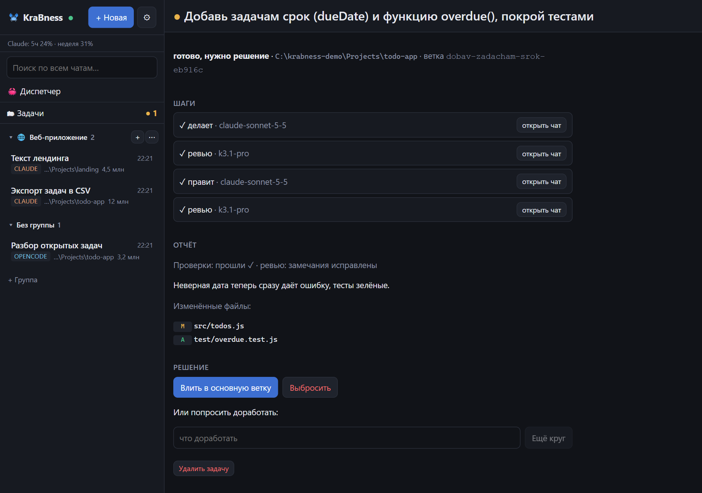
  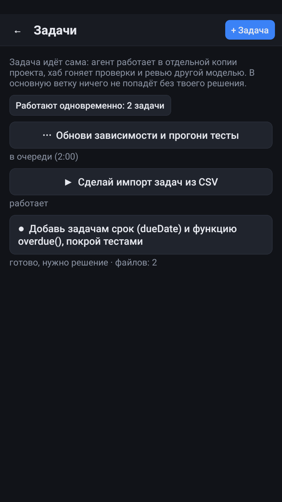
</p>

- **Очередь.** Задачи стартуют, когда есть место (по умолчанию две одновременно), или ночью: «Запустить ночью» ждёт до 02:00.
- **Любой движок.** Выбираешь модели для работы и для ревью. По умолчанию работа идёт на Claude, если вход выполнен, ревью на opencode.
- **Автопроверка в любой сессии.** ⋯ → Автопроверка в шапке чата включает проверки после каждого хода агента. Красная проверка уходит агенту, до трёх попыток, и останавливается раньше, если вернулась та же ошибка.
- **Упёрся в лимит Claude?** Сессия дождётся сброса и продолжит сама. «Не ждать» передаёт работу модели opencode.

<p align="center">
  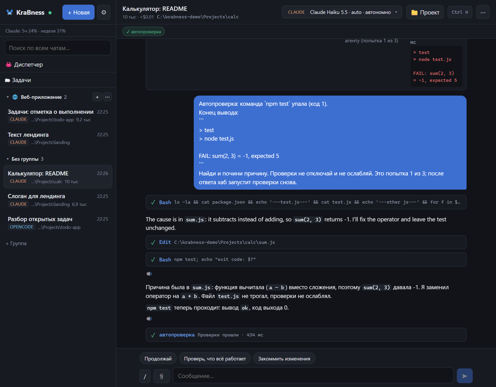
</p>

## Диспетчер

Закреплённый чат с помощником, который работает на тебя, а не на один проект. Зови его с телефона, из браузера или голосом.

<p align="center">
  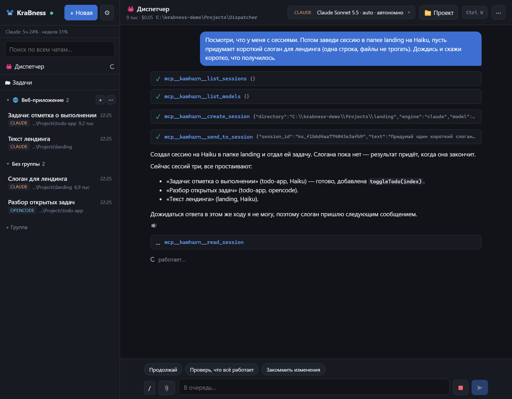
  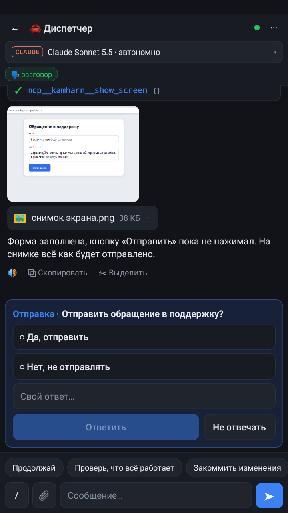
</p>

- **Раздаёт работу и остаётся свободным.** Запускает сессии и задачи и сразу отвечает тебе; хаб сам следит за сессиями и будит его, когда сессия закончила, спросила или упала. На их вопросы он отвечает, когда ответ очевиден, и докладывает. Команды, похожие на необратимые (push, удаление), сам не одобряет: они ждут твоего «да». Это проверка по шаблонам и указание модели, а не гарантия.
- **Может управлять ПК (Windows).** Снимки экрана, мышь, клавиатура, открытие сайтов.
- **С ним можно говорить**: на ПК по слову-активатору, на телефоне в режиме «Разговор».
- **Помнит**, что говорилось во всех твоих чатах, по дням.
- **Любой мозг, один чат.** Claude или любая модель opencode с инструментами, и запасная, когда Claude упёрся в лимит.

<details>
<summary>Диспетчер подробнее</summary>

- **Работа.** По его поручениям одновременно работают до трёх сессий (`dispatcher.maxSessions`); занятая сессия или папка ждёт своей очереди, а новая сессия в занятом git-проекте получает свою копию в отдельной ветке. Поручения переживают перезапуск хаба.
- **Управление ПК.** Нужен [uv](https://docs.astral.sh/uv/) (установщик предложит его поставить); чтобы прислать снимок в чат, нужен ещё ffmpeg.
- **Голос на ПК.** Скажи слово-активатор и команду, начало ответа прозвучит в колонках. Распознавание (Whisper) и речь (Piper) работают локально, фразы без слова-активатора никуда не уходят. «Настройки → Компьютер → Голос на ПК». Нужен uv, модели скачаются при первом запуске; с видеокартой NVIDIA работает быстро, без неё переходит на процессор. **Пока только по-русски.**
- **Голос на телефоне.** Нажми микрофон, говори, нажми стоп. В режиме «Разговор» текст уходит сам, а первый абзац ответа звучит вслух. У Диспетчера он включён по умолчанию, в любой сессии он есть в меню ⋯. На телефоне нужна служба распознавания речи.
- **Память.** В двух обычных файлах в его папке лежит то, что он должен знать всегда. Сверху долгая память в базе хаба на этом ПК: что говорилось во всех твоих чатах, включая прежние, по дням, поэтому можно спросить, что делали в такой-то день. Что она вспоминает, уходит модели Диспетчера, как любой контекст. Группу можно закрыть для памяти в её настройках. Найти записи или забыть подходящие можно в «Настройках → Агенты → Память» в вебе (до пяти за раз; дневник и сами чаты остаются). Сразу ищет по словам; дневнику и поиску по смыслу нужна локальная модель с API как у OpenAI (`memory.writer` и `memory.embeddings` в конфиге). В LM Studio модель должна быть уже загружена.
- **Мозги.** «Настройки → Агенты → Диспетчер»: основная модель и запасная. Нет Claude: сразу работает на любой модели opencode с инструментами. Основной Claude и выбран запасной: переходит на запасной, когда Claude упёрся в лимит или нет входа, и потом возвращается.

<p align="center">
  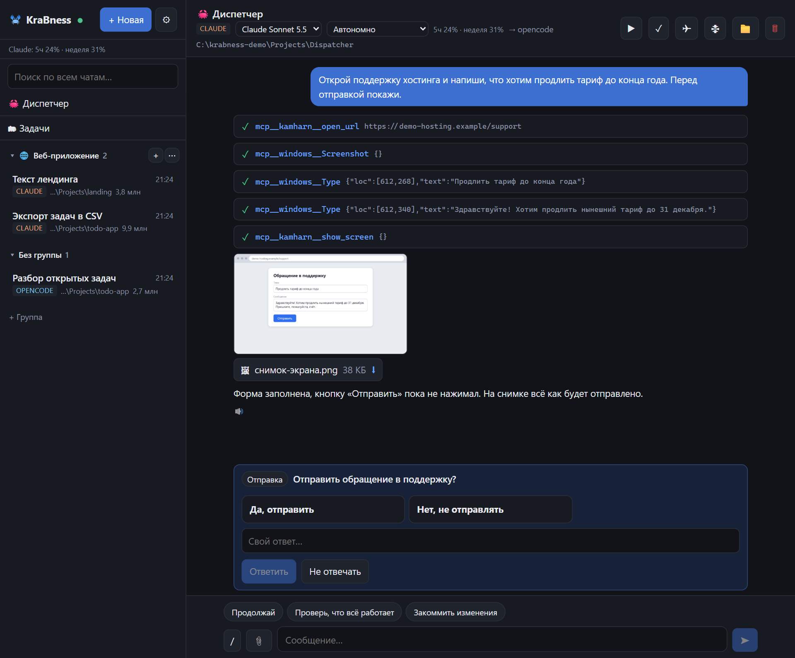
</p>
<p align="center">
  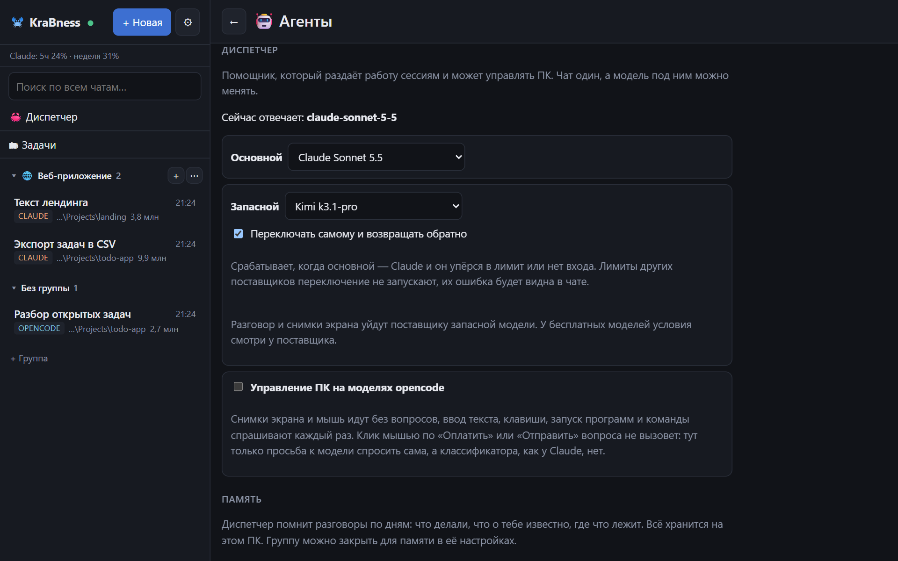
  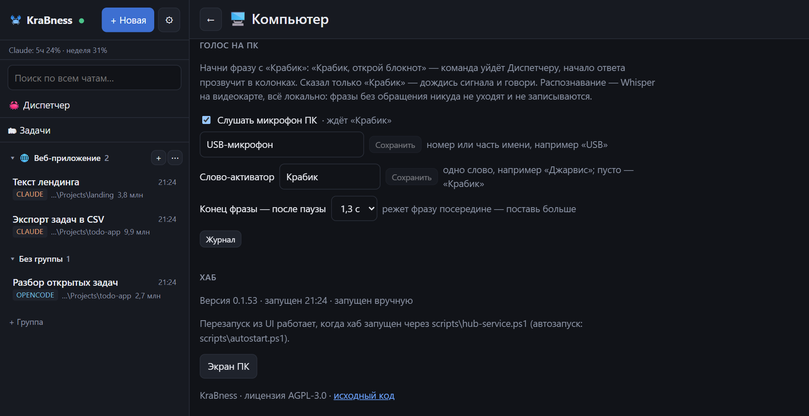
</p>

**Что важно знать про управление ПК на моделях opencode.** По умолчанию оно выключено, включается в тех же настройках. У Claude есть защитный классификатор, у моделей opencode его нет:

- снимки экрана и мышь идут без вопросов;
- ввод текста, клавиши, запуск программ и команды спрашивают каждый раз, на карточке видно, что именно;
- клик мышью по «Оплатить» или «Отправить» **не** спрашивает: тут только просьба к модели спросить сама, и насколько она послушается, зависит от модели.

Модели нужно зрение, иначе она работает без управления ПК. Разговор и снимки экрана уходят поставщику этой модели. Проверено на Kimi k3.1-pro; другие поставщики идут через тот же код, но живьём не проверялись.

</details>

## Живые страницы и замечания по вёрстке

- **Живые страницы.** Блок ```` ```html ```` с целой страницей в ответе агента работает прямо в чате: 3D, графики, небольшие демо, на весь экран в одно касание. Кусок разметки без `<!doctype html>` показывается кодом с кнопкой «Запустить». Если страница упала, карточка покажет ошибку и кнопку «Отправить агенту». Страница запускается в песочнице без доступа к хабу, твоему токену и чату. У `.html`-файла в просмотре проекта есть кнопка запуска.
- **Превью dev-сервера.** Открой порт своего dev-сервера на телефоне или в другом браузере через хаб.
- **Замечания по вёрстке.** Открой превью в режиме замечаний, нажми на элемент и напиши, что не так. Агент получит твой текст, селектор элемента, кусок его HTML, размеры и стили, а ещё снимок.

<p align="center">
  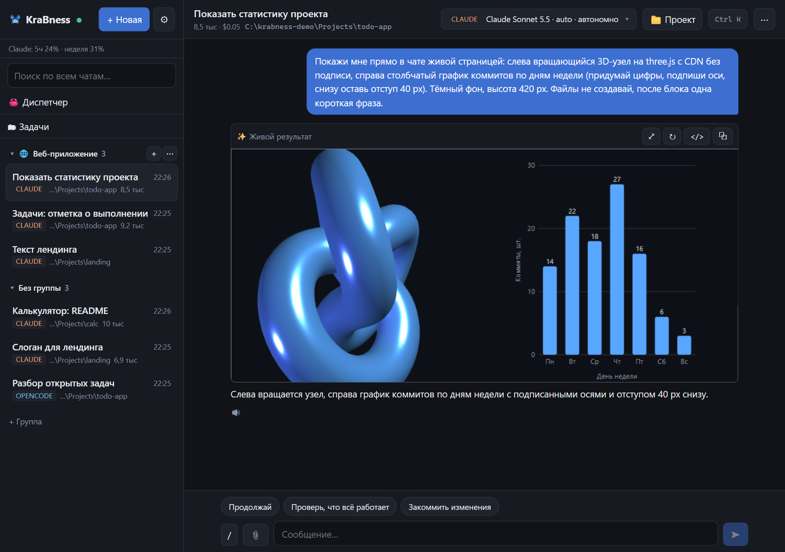
  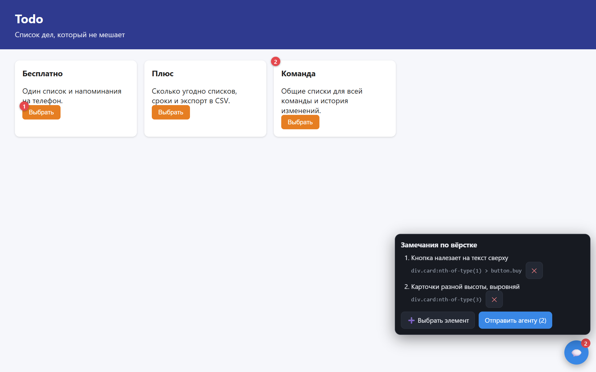
</p>

## Поиск и расход токенов

- **Поиск по всем чатам**, в вебе и в приложении. Ищет по началу слов в том, что писали ты и агенты, нажатие открывает сессию.
- **Расход токенов** («Настройки → Расход токенов»): новые токены, чтение из кэша и стоимость как по API, в виде календаря-тепловой карты, по дням, моделям и сессиям. По подписке стоимость только для ориентира.

<p align="center">
  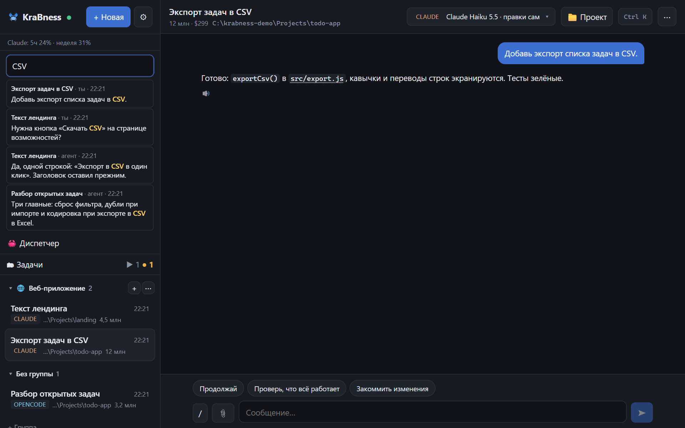
  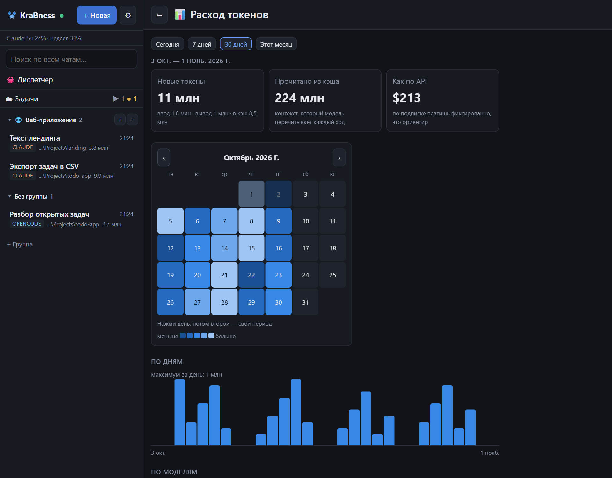
</p>

<p align="center">
  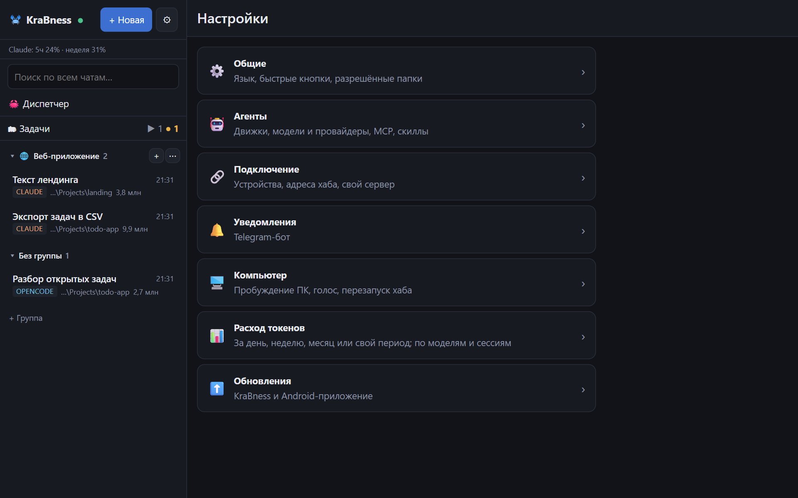
</p>

## Что нужно

- Windows 10 или 11 (хаб, его сторож, сон и снимок экрана пока только под Windows).
- [Node.js](https://nodejs.org) 22 или новее (лучше 24 LTS). Установщик предложит поставить.
- Хотя бы один агент:
  - **opencode**: `npm i -g opencode-ai`. Сразу работает с бесплатными и локальными моделями.
  - **Claude Code**: `npm i -g @anthropic-ai/claude-code`. Один раз войди своим аккаунтом: в KraBness (Настройки → Движки → Войти на ПК) или командой `claude auth login` в терминале. Подойдёт подписка Claude или API-ключ Anthropic (оплата по расходу, Настройки → Движки).
- [Tailscale](https://tailscale.com/download) на ПК и телефоне, один аккаунт. Он даёт телефону закрытый зашифрованный канал до ПК без проброса портов.
- По желанию: [uv](https://docs.astral.sh/uv/) для управления ПК и голоса на ПК (установщик предложит поставить).

## Установка

Открой PowerShell (не от администратора) и выполни:

```powershell
irm https://github.com/kamo4er/KraBness/releases/latest/download/install.ps1 | iex
```

Что делает установщик:
- проверяет Node.js и предлагает поставить, если его нет;
- качает последний выпуск в `%USERPROFILE%\KraBness`, ставит зависимости и собирает веб-интерфейс;
- предлагает поставить то, чего нет: opencode, Claude Code, uv (по желанию), Tailscale;
- спрашивает про правило брандмауэра для Tailscale и про автозапуск с Windows;
- запускает хаб и открывает http://127.0.0.1:7420.

<details>
<summary>Установка вручную</summary>

1. Скачай `krabness-<версия>.zip` из [последнего выпуска](https://github.com/kamo4er/KraBness/releases/latest) и распакуй в папку.
2. В этой папке собери:
   ```
   npm ci
   npm run web:build
   ```
3. Разреши телефону подключаться через Tailscale (один раз, от администратора):
   `powershell -ExecutionPolicy Bypass -File scripts\firewall-tailscale.ps1`
4. Запусти хаб под сторожем:
   `powershell -ExecutionPolicy Bypass -File scripts\hub-service.ps1 -Detach`
   Сторож перезапускает хаб и ставит обновления.
5. По желанию включи автозапуск с Windows:
   `powershell -ExecutionPolicy Bypass -File scripts\autostart.ps1`

Попробовать быстро, без сторожа: хватит `scripts\start-hub.cmd`, но обновления тогда ставить руками. На одном ПК одна установка: у автозапуска и задачи-страховки фиксированные имена.

</details>

## Подключить телефон

1. **Tailscale.** Поставь на телефон и войди в тот же аккаунт, что на ПК.
2. **Приложение.** Скачай `KraBness-<версия>.apk` из [последнего выпуска](https://github.com/kamo4er/KraBness/releases/latest) или в веб-интерфейсе: Настройки → Android-приложение → Скачать APK. Установи; Android попросит разрешить установку из этого источника.
3. **Сопряжение.**
   1. В веб-интерфейсе на ПК: Настройки → Подключить устройство. Код живёт 5 минут.
   2. В приложении отсканируй QR или впиши адрес ПК в Tailscale и 6-значный код.

Готово: сессии, чат, подтверждения и файлы теперь на телефоне. Запросам с самого ПК хаб доверяет, остальным устройствам нужен токен, который они получают при сопряжении. Агенты работают только в разрешённых папках: по умолчанию `%USERPROFILE%\Projects`, меняется в настройках.

Без приложения: открой в браузере телефона `http://<IP ПК в Tailscale>:7420` и введи тот же код.

<details>
<summary>Без Tailscale: через свой сервер</summary>

Если Tailscale с телефона не работает (например, VPN на ПК ломает его в мобильной сети), хаб может ходить через твой VPS. ПК сам держит к серверу исходящий SSH-туннель, а сервер раздаёт хаб по HTTPS с бесплатным сертификатом Let's Encrypt. Открывать порты на ПК и домашнем роутере не нужно.

1. Нужен VPS с Ubuntu или Debian, на котором свободны порты 80 и 443. Домен не нужен: адрес будет `https://krab.<ip-сервера>.sslip.io`.
2. В веб-интерфейсе на ПК открой «Настройки → Удалённый доступ через свой сервер» и скопируй команду. Выполни её на VPS под root. Она поставит Caddy и пользователя `krabtunnel`, ключу которого разрешён только этот туннель ([`scripts/vps-setup.sh`](scripts/vps-setup.sh), повторный запуск ничего не ломает).
3. Впиши IP сервера и нажми «Сохранить и подключить». Хаб сам проверит адрес снаружи.

Новый адрес попадает в QR для сопряжения, а уже подключённое приложение узнаёт его само при следующем подключении. Приложение пробует все известные адреса и берёт тот, что отвечает: дома Tailscale, в мобильной сети твой сервер.


</details>

## Уведомления

Приложение узнаёт, что агенту нужно подтверждение, у него вопрос, ошибка или он закончил. Подойдёт любой из способов ниже. Пока ты активен в веб-интерфейсе на ПК, уведомления не приходят.

- **Из приложения (по умолчанию).** Хаб присылает уведомления по своему соединению, приложение показывает их само. Включи «Настройки → Держать связь в фоне», чтобы свёрнутое приложение не теряло связь.
- **Telegram.** Создай бота у [@BotFather](https://t.me/BotFather), вставь токен в «Настройки → Уведомления в Telegram» и отправь боту `/start <код>`.
  - Кнопки «Разрешить» и «Отклонить» работают прямо в чате.
  - Ответ на уведомление уходит агенту.
  - Если Telegram у тебя заблокирован, там же укажи SOCKS5- или HTTP-прокси.

Нужны уведомления, даже когда Android выгрузил приложение? Подключи Telegram: он от приложения вообще не зависит.

## Обновления

Хаб раз в сутки смотрит [GitHub Releases](https://github.com/kamo4er/KraBness/releases). Когда выходит новая версия, в вебе и в приложении появляется плашка с тем, что нового, и кнопкой **Обновить**. Дальше:
1. Хаб скачивает выпуск и перезапускается.
2. Сторож меняет файлы, ставит зависимости и собирает веб-интерфейс.
3. Если новая версия не встала или сразу упала, сторож возвращает прежнюю.

Данные, настройки и ключи не трогаются. Приложение на телефоне обновится следом само. В «Настройках → Обновления» есть «Проверить сейчас» и переключатель ежедневной проверки.

Хочешь письмом? На GitHub нажми **Watch → Custom → Releases**.

<details>
<summary>Пробуждение ПК (по желанию)</summary>

Спящий ПК недоступен по сети, поэтому его будит маленький «будильник». Это скрипт `scripts/nas-wake/wake.py` на любом постоянно включённом устройстве в той же домашней сети: NAS, Raspberry Pi, роутер с Python 3.8+. Телефон зовёт будильник через Tailscale, а тот шлёт ПК сигнал Wake-on-LAN. Без будильника всё остальное работает, просто не будет кнопки «Разбудить ПК».

1. Включи Wake-on-LAN на ПК:
   - в BIOS: Wake on LAN / Power On By PCI-E;
   - в Windows: Диспетчер устройств → сетевая карта → «Дополнительно» → *Wake on Magic Packet* = Вкл;
   - в «Управлении электропитанием»: разрешить выводить компьютер из ждущего режима.

   Лучше по кабелю: по Wi-Fi Wake-on-LAN работает редко.
2. На устройстве-будильнике поставь Tailscale (тот же аккаунт).
3. В веб-интерфейсе на ПК: Настройки → Пробуждение ПК. Выбери сетевую карту, нажми «Сгенерировать» токен и скачай `wake.py`.
4. На будильнике положи `wake.py`, а рядом файл `token` с этим токеном. Запусти:
   ```
   python3 wake.py --bind <IP будильника в Tailscale>
   ```
5. В настройках впиши `http://<IP будильника в Tailscale>:7421` и нажми «Сохранить и проверить».

Автозапуск на Linux (Raspberry Pi и т. п.): `/etc/systemd/system/krabness-wake.service`

```
[Unit]
Description=KraBness wake relay
After=network-online.target tailscaled.service
Wants=network-online.target

[Service]
WorkingDirectory=/home/pi/krabness-wake
ExecStart=/usr/bin/python3 wake.py --bind <IP в Tailscale>
Restart=always
User=pi

[Install]
WantedBy=multi-user.target
```

затем `sudo systemctl enable --now krabness-wake`.

Synology: Панель управления → Планировщик задач → Создать → Задача по событию «Загрузка». Скрипт на выбор:
- `cd ~/krabness-wake && python3 wake.py --bind <IP в Tailscale>`;
- `scripts/nas-wake/run.sh`: он ещё и перезапускает упавший будильник.

</details>

## Вопросы

**Чей аккаунт Claude используется?** Твой. Вход хранит сам Claude Code на твоём ПК, KraBness его только запускает. Ничей чужой аккаунт в KraBness не зашит. В «Настройках → Движки» видно, кто вошёл; там же можно войти заново или работать по API-ключу.

**Подписка Claude используется законно?** Да. KraBness запускает официальный `claude` CLI, тот же, что у тебя в терминале. Токены твоей сессии он в API не отправляет.

**Кто может достучаться до моего ПК?** Только устройства, которые ты подключил по коду. Через Tailscale хаб вообще не виден из интернета, а правило брандмауэра пускает только через интерфейс Tailscale. Через свой сервер хаб доступен из интернета, но каждому запросу нужен токен устройства; код сопряжения живёт 5 минут после запуска сопряжения на ПК, а пять неверных кодов его сжигают. Запросы через туннель никогда не считаются локальными, хотя приходят с 127.0.0.1. Другими способами хаб наружу не выставляй (`tailscale funnel`, проброс портов, свой прокси): подключённое устройство может запускать команды на ПК, в этом и смысл приложения.

**Обновления безопасны?** Каждый архив выпуска подписан ключом автора, и хаб не ставит архив без верной подписи, даже если он лежит на правильной странице GitHub.

**А macOS или Linux?** Клиенты работают где угодно. Сам хаб пока только под Windows: сторож, сон и снимок экрана.

**Почему кое-где «kamharn»?** Это рабочее имя проекта. Пакет приложения (`dev.kamharn.app`), файл конфига и задачи Windows его сохраняют, чтобы обновления продолжали работать у всех, кто уже поставил.

**Как удалить?**
1. Останови хаб и выключи автозапуск:
   ```
   scripts\hub-service.ps1 -Stop
   scripts\autostart.ps1 -Remove
   ```
2. Удали папку.
3. Правило брандмауэра называется «KamHarn hub (Tailscale)».
4. Если настраивал свой сервер: на VPS удали пользователя `krabtunnel` и блок между метками `# >>> krabness` в `/etc/caddy/Caddyfile`.

## Конфиг

`config/kamharn.json` создаётся при первом запуске. В нём:
- адреса и порт;
- разрешённые папки;
- движки (`engines.claude.userMcp: true` подключает ещё и MCP-серверы из настроек Claude Code);
- язык (`language`: `auto`, `ru` или `en`);
- обновления (`updates.auto: false` выключает ежедневную проверку);
- Диспетчер: сколько сессий одновременно работают по его поручениям (`dispatcher.maxSessions`, по умолчанию 3);
- долгая память Диспетчера (`memory.enabled: false` выключает её; `memory.writer` и `memory.embeddings` это локальные модели для дневника и поиска по смыслу);
- удалённый доступ через свой сервер (`remote`; ключ туннеля хаба лежит в `config/remote_ed25519`);
- адреса за своим обратным прокси, например NAS на белом IP (`publicUrls`, попадают в QR). Домашний адрес ПК добавь в `listen` и запусти от администратора `scripts\firewall-lan.ps1 -Proxy <IP прокси>`: порт хаба будет пускать только прокси.

Почти всё это есть и в интерфейсе.

## Разработка

```
npm run hub               # хаб вручную, интерфейс на http://127.0.0.1:7420
npm run web:dev           # интерфейс с горячей перезагрузкой на :5173
npm run typecheck
npm test                  # юнит-тесты
npm run test:integration  # живые: настоящие opencode и claude (тратят немного квоты)
```

Заметки для агентов (и людей) лежат в [AGENTS.md](AGENTS.md).

## Лицензия

KraBness распространяется по лицензии [GNU AGPL-3.0](LICENSE). Пользуйся, меняй, делись. Если раздаёшь изменённую версию или запускаешь её как сервис для других людей, открой её исходный код на тех же условиях.

Copyright (C) 2026 kamo4er
