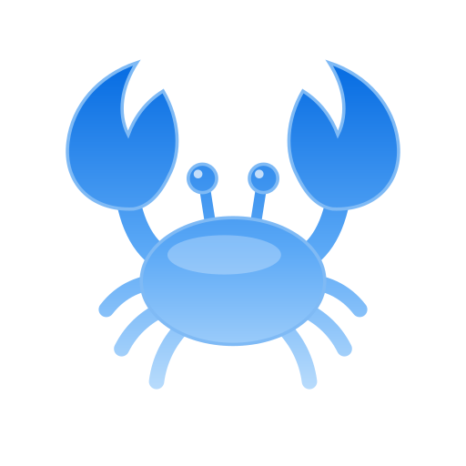
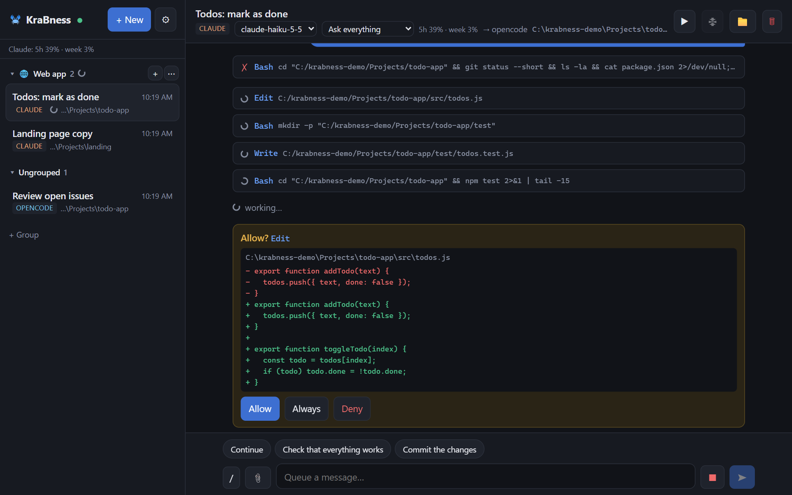
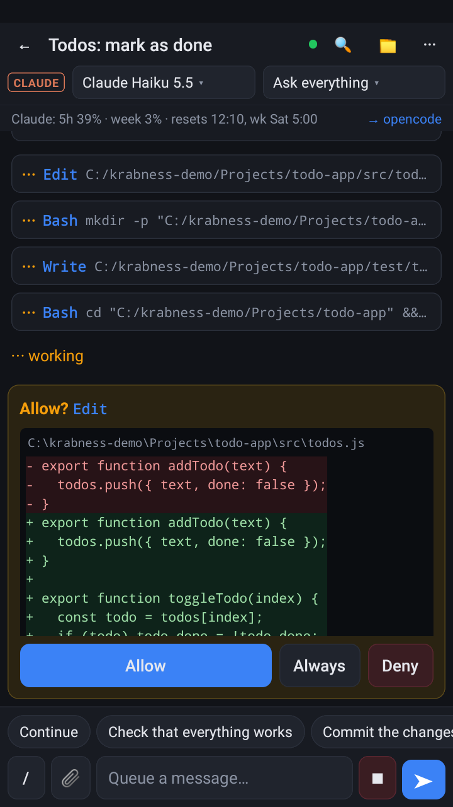
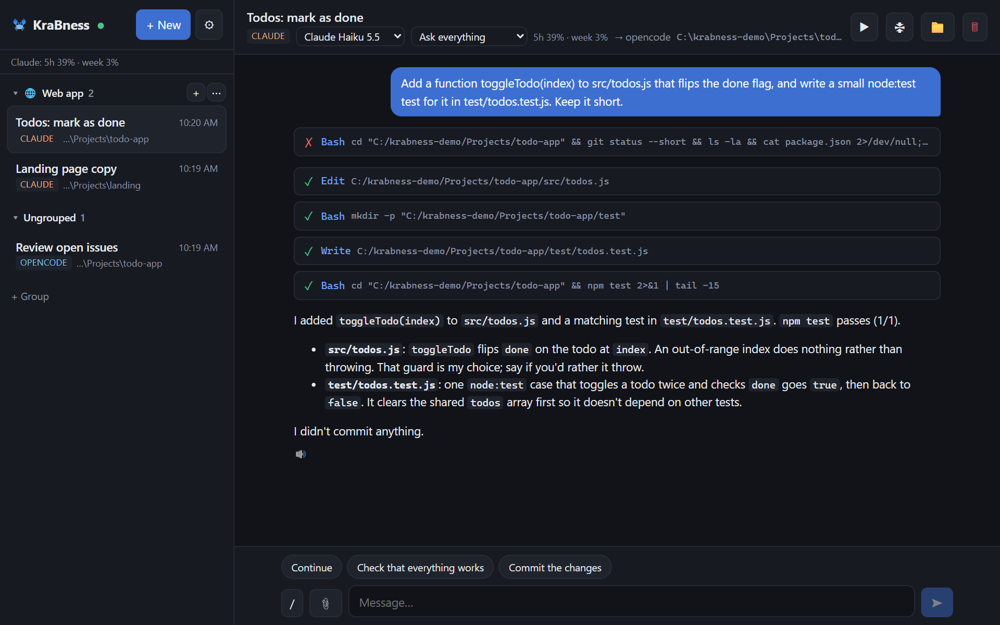
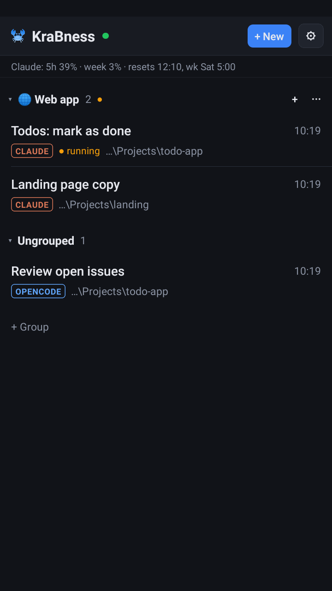

<p align="center"></p>

<h1 align="center">KraBness</h1>

<p align="center"><b>AI-агенты работают на твоём ПК. Управляешь ими с телефона.</b><br>
Свой сервер, любые модели, без привязки к одному вендору.</p>

<p align="center"><a href="README.md">English version</a></p>

---

KraBness это небольшой хаб, который работает на твоём ПК с Windows. Он запускает AI-агентов для кода:
- [opencode](https://opencode.ai) с любой моделью;
- или официальный [Claude Code](https://claude.com/claude-code) CLI по твоей подписке.

Веб-интерфейс и Android-приложение показывают одну и ту же живую сессию откуда угодно. Начал задачу за столом, разрешил команду с дивана, прочитал результат в автобусе.

<p align="center">
  
  
</p>
<p align="center">
  
  
</p>

```
 телефон (приложение) ┐               ┌─► opencode   локальные модели, LM Studio, Ollama, бесплатные облачные, любой API-ключ
 браузер (веб-UI)     ├──Tailscale──► хаб KraBness (твой ПК)
                      ┘               └─► claude     официальный Claude Code CLI, твоя подписка
                                           │
                                           └─ журнал событий, файлы, подтверждения, уведомления, обновления
```

## Что умеет

- **Одна живая сессия везде.**
  - Каждое событие ложится в журнал, клиенты догружают пропущенное.
  - Телефон хранит кэш чатов и черновик того, что ты начал писать.
- **Подтверждения и вопросы агента** приходят кнопками. Ответить можно в вебе, в приложении, прямо из уведомления или в Telegram.
- **Файлы в обе стороны.** Приложи файл, фото или снимок с камеры; агент присылает файлы тебе.
- **Любые модели.**
  - opencode работает с OpenAI (в том числе по подписке ChatGPT), OpenRouter, DeepSeek, Gemini, Kimi, GLM.
  - Ещё он работает со своим сервером (LM Studio, Ollama, vLLM) и с бесплатными моделями.
  - Claude Code работает по твоей подписке Claude, только через официальный CLI.
- **Просмотр проекта без агента**: git diff, файлы, правка текстовых файлов руками, мини-терминал.
- **Полезное сверху**:
  - лимиты Claude в процентах и автопродолжение после сброса лимита;
  - отдельная git-ветка на сессию;
  - группы сессий с общим промптом;
  - свои MCP-серверы и скиллы для обоих движков;
  - продолжение сессий Claude Code;
  - превью dev-сервера на телефоне;
  - снимок экрана ПК;
  - голосовой ввод и озвучка;
  - усыпить и разбудить ПК.
- **Уведомления**: из самого приложения или через Telegram-бота (умеет SOCKS5/HTTP-прокси).
- **Обновления в одно касание.** Хаб раз в сутки смотрит GitHub, ставит новую версию и откатывается, если что-то пошло не так.
- **Русский и английский** интерфейс, по умолчанию как в системе.

## Что нужно

- Windows 10 или 11 (хаб, его сторож, сон и снимок экрана пока только под Windows).
- [Node.js](https://nodejs.org) 22 или новее (лучше 24 LTS). Установщик предложит поставить.
- Хотя бы один агент:
  - **opencode**: `npm i -g opencode-ai`. Сразу работает с бесплатными и локальными моделями.
  - **Claude Code**: `npm i -g @anthropic-ai/claude-code`. Один раз войди своим аккаунтом: в KraBness (Настройки → Движки → Войти на ПК) или командой `claude auth login` в терминале. Подойдёт подписка Claude или API-ключ Anthropic (оплата по расходу, Настройки → Движки).
- [Tailscale](https://tailscale.com/download) на ПК и телефоне, один аккаунт. Он даёт телефону закрытый зашифрованный канал до ПК без проброса портов.

## Установка

Открой PowerShell (не от администратора) и выполни:

```powershell
irm https://github.com/kamo4er/KraBness/releases/latest/download/install.ps1 | iex
```

Что делает установщик:
- проверяет Node.js и предлагает поставить, если его нет;
- качает последний выпуск в `%USERPROFILE%\KraBness`, ставит зависимости и собирает веб-интерфейс;
- предлагает поставить то, чего нет: opencode, Claude Code, Tailscale;
- спрашивает про правило брандмауэра для Tailscale и про автозапуск с Windows;
- запускает хаб и открывает http://127.0.0.1:7420.

<details>
<summary>Установка вручную</summary>

1. Скачай `krabness-<версия>.zip` из [последнего выпуска](https://github.com/kamo4er/KraBness/releases/latest) и распакуй в папку.
2. В этой папке собери:
   ```
   npm ci
   npm run web:build
   ```
3. Разреши телефону подключаться через Tailscale (один раз, от администратора):
   `powershell -ExecutionPolicy Bypass -File scripts\firewall-tailscale.ps1`
4. Запусти хаб под сторожем:
   `powershell -ExecutionPolicy Bypass -File scripts\hub-service.ps1 -Detach`
   Сторож перезапускает хаб и ставит обновления.
5. По желанию включи автозапуск с Windows:
   `powershell -ExecutionPolicy Bypass -File scripts\autostart.ps1`

Попробовать быстро, без сторожа: хватит `scripts\start-hub.cmd`, но обновления тогда ставить руками. На одном ПК одна установка: у автозапуска и задачи-страховки фиксированные имена.

</details>

## Подключить телефон

1. **Tailscale.** Поставь на телефон и войди в тот же аккаунт, что на ПК.
2. **Приложение.** Скачай `KraBness-<версия>.apk` из [последнего выпуска](https://github.com/kamo4er/KraBness/releases/latest) или в веб-интерфейсе: Настройки → Android-приложение → Скачать APK. Установи; Android попросит разрешить установку из этого источника.
3. **Сопряжение.**
   1. В веб-интерфейсе на ПК: Настройки → Подключить устройство. Код живёт 5 минут.
   2. В приложении отсканируй QR или впиши адрес ПК в Tailscale и 6-значный код.

Готово: сессии, чат, подтверждения и файлы теперь на телефоне. Запросам с самого ПК хаб доверяет, остальным устройствам нужен токен, который они получают при сопряжении. Агенты работают только в разрешённых папках: по умолчанию `%USERPROFILE%\Projects`, меняется в настройках.

Без приложения: открой в браузере телефона `http://<IP ПК в Tailscale>:7420` и введи тот же код.

## Уведомления

Приложение узнаёт, что агенту нужно подтверждение, у него вопрос, ошибка или он закончил. Подойдёт любой из способов ниже. Пока ты активен в веб-интерфейсе на ПК, уведомления не приходят.

- **Из приложения (по умолчанию).** Хаб присылает уведомления по своему соединению, приложение показывает их само. Включи «Настройки → Держать связь в фоне», чтобы свёрнутое приложение не теряло связь.
- **Telegram.** Создай бота у [@BotFather](https://t.me/BotFather), вставь токен в «Настройки → Уведомления в Telegram» и отправь боту `/start <код>`.
  - Кнопки «Разрешить» и «Отклонить» работают прямо в чате.
  - Ответ на уведомление уходит агенту.
  - Если Telegram у тебя заблокирован, там же укажи SOCKS5- или HTTP-прокси.

Нужны уведомления, даже когда Android выгрузил приложение? Подключи Telegram: он от приложения вообще не зависит.

## Обновления

Хаб раз в сутки смотрит [GitHub Releases](https://github.com/kamo4er/KraBness/releases). Когда выходит новая версия, в вебе и в приложении появляется плашка с тем, что нового, и кнопкой **Обновить**. Дальше:
1. Хаб скачивает выпуск и перезапускается.
2. Сторож меняет файлы, ставит зависимости и собирает веб-интерфейс.
3. Если новая версия не встала или сразу упала, сторож возвращает прежнюю.

Данные, настройки и ключи не трогаются. Приложение на телефоне обновится следом само. В «Настройках → Обновления» есть «Проверить сейчас» и переключатель ежедневной проверки.

Хочешь письмом? На GitHub нажми **Watch → Custom → Releases**.

## Пробуждение ПК (по желанию)

Спящий ПК недоступен по сети, поэтому его будит маленький «будильник». Это скрипт `scripts/nas-wake/wake.py` на любом постоянно включённом устройстве в той же домашней сети: NAS, Raspberry Pi, роутер с Python 3.8+. Телефон зовёт будильник через Tailscale, а тот шлёт ПК сигнал Wake-on-LAN. Без будильника всё остальное работает, просто не будет кнопки «Разбудить ПК».

1. Включи Wake-on-LAN на ПК:
   - в BIOS: Wake on LAN / Power On By PCI-E;
   - в Windows: Диспетчер устройств → сетевая карта → «Дополнительно» → *Wake on Magic Packet* = Вкл;
   - в «Управлении электропитанием»: разрешить выводить компьютер из ждущего режима.

   Лучше по кабелю: по Wi-Fi Wake-on-LAN работает редко.
2. На устройстве-будильнике поставь Tailscale (тот же аккаунт).
3. В веб-интерфейсе на ПК: Настройки → Пробуждение ПК. Выбери сетевую карту, нажми «Сгенерировать» токен и скачай `wake.py`.
4. На будильнике положи `wake.py`, а рядом файл `token` с этим токеном. Запусти:
   ```
   python3 wake.py --bind <IP будильника в Tailscale>
   ```
5. В настройках впиши `http://<IP будильника в Tailscale>:7421` и нажми «Сохранить и проверить».

<details>
<summary>Автозапуск будильника</summary>

Linux (Raspberry Pi и т. п.): `/etc/systemd/system/kamharn-wake.service`

```
[Unit]
Description=KraBness wake relay
After=network-online.target tailscaled.service
Wants=network-online.target

[Service]
WorkingDirectory=/home/pi/kamharn-wake
ExecStart=/usr/bin/python3 wake.py --bind <IP в Tailscale>
Restart=always
User=pi

[Install]
WantedBy=multi-user.target
```

затем `sudo systemctl enable --now kamharn-wake`.

Synology: Панель управления → Планировщик задач → Создать → Задача по событию «Загрузка». Скрипт на выбор:
- `cd ~/kamharn-wake && python3 wake.py --bind <IP в Tailscale>`;
- `scripts/nas-wake/run.sh`: он ещё и перезапускает упавший будильник.

</details>

## Вопросы

**Чей аккаунт Claude используется?** Твой. Вход хранит сам Claude Code на твоём ПК, KraBness его только запускает. Ничей чужой аккаунт в KraBness не зашит. В «Настройках → Движки» видно, кто вошёл; там же можно войти заново или работать по API-ключу.

**Подписка Claude используется законно?** Да. KraBness запускает официальный `claude` CLI, тот же, что у тебя в терминале. Токены твоей сессии он в API не отправляет.

**Кто может достучаться до моего ПК?** Только устройства из твоей сети Tailscale, которые ты подключил по коду. В открытый интернет хаб не смотрит, а правило брандмауэра пускает только через интерфейс Tailscale. Не выставляй хаб наружу через `tailscale funnel` или другой туннель: подключённое устройство может запускать команды на ПК, в этом и смысл приложения.

**Обновления безопасны?** Каждый архив выпуска подписан ключом автора, и хаб не ставит архив без верной подписи, даже если он лежит на правильной странице GitHub.

**А macOS или Linux?** Клиенты работают где угодно. Сам хаб пока только под Windows: сторож, сон и снимок экрана.

**Как удалить?**
1. Останови хаб и выключи автозапуск:
   ```
   scripts\hub-service.ps1 -Stop
   scripts\autostart.ps1 -Remove
   ```
2. Удали папку.
3. Правило брандмауэра называется «KamHarn hub (Tailscale)».

## Конфиг

`config/kamharn.json` создаётся при первом запуске. В нём:
- адреса и порт;
- разрешённые папки;
- движки (`engines.claude.userMcp: true` подключает ещё и MCP-серверы из настроек Claude Code);
- язык (`language`: `auto`, `ru` или `en`);
- обновления (`updates.auto: false` выключает ежедневную проверку).

Почти всё это есть и в интерфейсе.

## Разработка

```
npm run hub               # хаб вручную, интерфейс на http://127.0.0.1:7420
npm run web:dev           # интерфейс с горячей перезагрузкой на :5173
npm run typecheck
npm test                  # юнит-тесты
npm run test:integration  # живые: настоящие opencode и claude (тратят немного квоты)
```

Заметки для агентов (и людей) лежат в [AGENTS.md](AGENTS.md).

## Лицензия

KraBness распространяется по лицензии [GNU AGPL-3.0](LICENSE). Пользуйся, меняй, делись. Если раздаёшь изменённую версию или запускаешь её как сервис для других людей, открой её исходный код на тех же условиях.

Copyright (C) 2026 kamo4er
